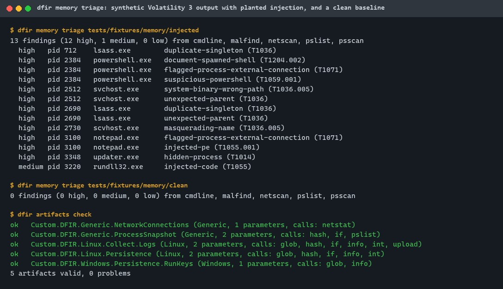
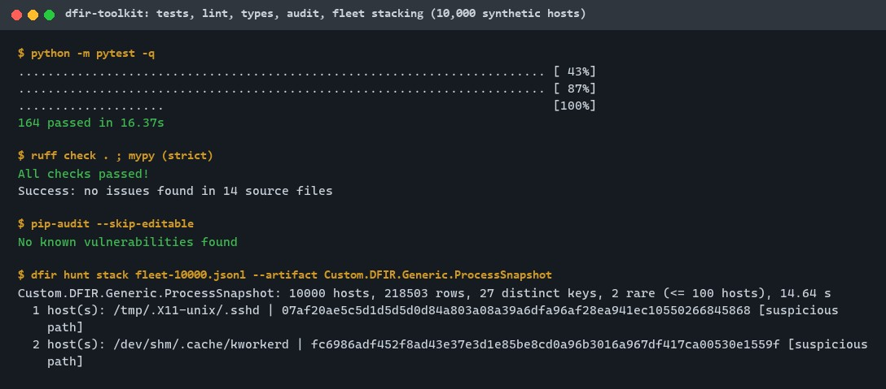
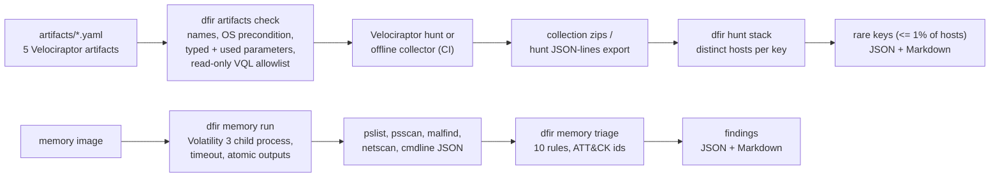
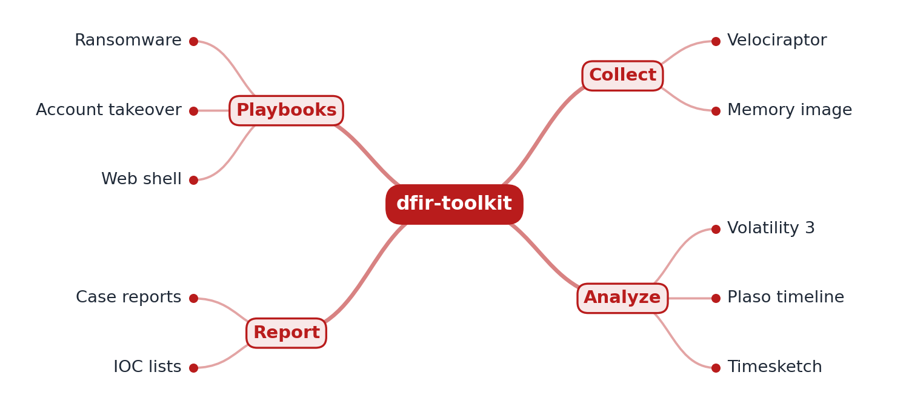

# dfir-toolkit

[](https://github.com/EquinoxWN/dfir-toolkit/actions/workflows/ci.yml)


> Velociraptor evidence-collection artifacts behind a read-only safety gate, least-frequency stacking of hunt results across a fleet, and Volatility 3 memory triage that flags hidden, masquerading and injected processes.

Part of my **Cyber Security** list · Python

## Proof it works

Memory triage on synthetic Volatility 3 output for a fictional Windows host: exactly the 13 planted
findings (hidden, masquerading and injected processes, a document starting encoded PowerShell, external
connections from flagged processes), 0 findings on the clean baseline, and all five artifacts through
the safety gate:



164 tests pass, lint and strict types are clean, the dependency audit finds nothing, and stacking a
10,000-host hunt export (218,503 rows) surfaces exactly the two planted executables:



## Architecture

**What M1 runs today:**



**Full roadmap (M1 to M3):**



## How it works

_Steps 1 and 2 are built and tested (M1); the rest is on the [roadmap](#roadmap)._

1. Velociraptor artifacts collect evidence from endpoints at scale.
2. Volatility 3 analyzes memory images for malicious processes and injected code.
3. Plaso builds a super-timeline, and Timesketch lets you explore it.
4. Playbooks guide the response to common incidents.
5. Each playbook is exercised on a public challenge image.
6. Case reports document the findings, timeline and indicators of compromise.

In M1, step 1 is five artifacts, a static gate that keeps them read-only, and stacking of their results
across hosts; step 2 is a Volatility 3 runner plus triage rules over its JSON output.

| Artifact | Collects | Stack key |
|---|---|---|
| `Custom.DFIR.Generic.ProcessSnapshot` | processes with parent, user, command line, executable and its SHA-256 | executable path + SHA-256 |
| `Custom.DFIR.Generic.NetworkConnections` | sockets with owning PID, addresses, state | remote address + port |
| `Custom.DFIR.Linux.Persistence` | cron, systemd units, profile scripts, `authorized_keys`, hashed | path + SHA-256 |
| `Custom.DFIR.Windows.Persistence.RunKeys` | Run and RunOnce values for the machine and every user hive | value name + command |
| `Custom.DFIR.Linux.Collect.Logs` | auth, syslog, wtmp/btmp uploaded as evidence with SHA-256 | path |

| Triage rule | Flags | ATT&CK |
|---|---|---|
| hidden-process | in psscan, not in pslist, not exited | T1014 |
| unexpected-parent | services, lsass, svchost, ... started by the wrong parent | T1036 |
| duplicate-singleton | more than one lsass, services, wininit, lsaiso | T1036 |
| masquerading-name | within two edits of a core name (known-good names excluded) | T1036.005 |
| system-binary-wrong-path | core binary run from outside System32/SysWOW64 | T1036.005 |
| document-spawned-shell | Word, Excel, Outlook, ... starting cmd, PowerShell, mshta, ... | T1204.002 |
| suspicious-powershell | encoded command, hidden window, download cradle | T1059.001 |
| injected-pe / injected-code | private RWX memory starting with MZ / holding code | T1055.001 / T1055 |
| flagged-process-external-connection | established connection to a non-internal address from a flagged process | T1071 |

## Who it helps

- **Who:** incident responders and SOC analysts in small teams, and students learning DFIR.
- **The problem:** custom Velociraptor artifacts fail or misbehave only when a hunt runs; hunt results
  across thousands of hosts are too many rows to read; Volatility output is checked by eye.
- **How to use it:** run `dfir artifacts check` before a hunt, collect with the artifacts, run
  `dfir hunt stack` on the exported results to get the handful of executables, persistence files or
  destinations that only a few hosts have, and run `dfir memory run` and `dfir memory triage` on the
  memory image of the worst-looking host to get a ranked list of suspicious processes.

## Tech stack

| Area | In M1 | Planned |
|---|---|---|
| Collect | Velociraptor artifacts (VQL), static safety gate, collection zip and hunt export readers | Velociraptor server notebooks |
| Analyze | Volatility 3 (5 Windows plugins), triage rules with ATT&CK ids, least-frequency stacking | Plaso (log2timeline), Timesketch |
| Data/Docs | synthetic Volatility JSON fixtures, synthetic fleet generator | playbooks, public challenge images, case reports |

Language: **Python** (3.11+). Code in [`src/dfir_toolkit/`](src/dfir_toolkit): `artifacts.py` (gate),
`hunt.py` (readers and stacking), `synth.py` (synthetic fleet), `volrunner.py` and `memory.py`
(Volatility runner and triage), `cli.py` (`dfir`).

## Run it

**Prerequisites:** Python 3.11+. Volatility 3 is installed with the `vol` extra (it is published under
the Volatility Software License and runs as a child process). Velociraptor is optional: download a
release from its project page to run the artifacts; CI uses v0.77.3.

```bash
python -m venv .venv && source .venv/bin/activate   # Windows: .venv\Scripts\activate
make setup     # pip install -e ".[dev,vol]"
make lint      # ruff, ruff format, mypy --strict, dfir artifacts check
make test      # 164 tests
make bench     # stack a synthetic 10,000-host hunt export
make triage    # triage the synthetic memory fixtures
```

Typical use during an incident:

```bash
dfir artifacts check artifacts
# collect with Velociraptor, then stack the exported hunt results or offline-collector zips
dfir hunt stack hunt-export.jsonl --artifact Custom.DFIR.Generic.ProcessSnapshot --md rare.md
dfir hunt stack collections/*.zip --artifact Custom.DFIR.Linux.Persistence --rare-fraction 0.02
# memory image of the worst-looking host
dfir memory run --image host17.raw --outdir case/host17     # add --offline if symbols are already cached
dfir memory triage case/host17 --json findings.json --md findings.md --fail-on high
```

Exit codes: 0 success, 1 invalid input or a Volatility failure, 2 invalid arguments, 3 `--fail-on`
matched. No environment variables are read by the toolkit; Volatility writes its symbol cache to the
`.volcache` folder inside `--outdir`.

## Tests and results

Full numbers and commands: [docs/results/m1.md](docs/results/m1.md). The 10-rule quality check and the
mutation table (11 hand mutations, all killed) are in [docs/quality/2026-11-01.md](docs/quality/2026-11-01.md).

| Test file | Tests | What it proves |
|---|---|---|
| `tests/test_artifacts.py` | 33 | Shipped artifacts pass; 13 defect classes (including `execve`, `http_client`, `rm`, unused parameters, missing OS precondition) and bad defaults are rejected; strings and comments are not mistaken for calls |
| `tests/test_hunt.py` | 39 | JSON-lines and zip readers (hosts, line numbers, size limits, decompression cap, no extraction); threshold; stacking by distinct host; planted executables are exactly the rare set on 5 seeds |
| `tests/test_memory.py` | 58 | Exactly 13 findings on the planted image, 0 on the clean one; every rule fires and stays quiet on known-good look-alikes; malformed Volatility output is rejected |
| `tests/test_volrunner.py` | 15 | Fake Volatility: success writes atomically, failure, garbage and a hang leave no file; real Volatility 3 (2.28.2): column contract for the 5 plugins and a clean failure on a non-image |
| `tests/test_cli.py` | 16 | `dfir` end to end, exit codes 0/1/2/3, JSON and Markdown reports |
| `tests/test_io.py` | 3 | Atomic writes and bounded reads |

| Check | Result |
|---|---|
| Tests | **164 passed**, 0 failed, 0 skipped (local, Python 3.14.5) |
| Memory triage, planted image | 13 findings (12 high, 1 medium), exactly the planted set; clean baseline 0 |
| Stacking 10,000 hosts, 218,503 rows | 2 rare keys, both planted; 3.3 s CPU, 3.9 s wall (best of 3, one thread) |
| Lint / types / audit | ruff and mypy `--strict` clean; `pip-audit`: no known vulnerabilities |
| Velociraptor collection with the artifacts | CI job (pinned v0.77.3, SHA-256 checked); not yet run |

## Roadmap

**M1** (≈8 h)
- [x] Write `docs/rfc/0001-design.md`: problem, goals, non-goals, chosen design
- [x] Velociraptor artifacts collect evidence from endpoints at scale.
- [x] Volatility 3 analyzes memory images for malicious processes and injected code.

**M2** (≈8 h)
- [ ] Plaso builds a super-timeline, and Timesketch lets you explore it.
- [ ] Playbooks guide the response to common incidents.

**M3** (≈9 h)
- [ ] Each playbook is exercised on a public challenge image.
- [ ] Case reports document the findings, timeline and indicators of compromise.
- [ ] Publish the proof below with real numbers

## Proof

What this repo must show before it counts as done:

- Case reports from solved public DFIR challenges.

| Result | Value |
|---|---|
| M3 proof above | Not measured yet (M3). Current M1 numbers: see [Tests and results](#tests-and-results). |

## Why it matters

- **Interview angle:** 'Walk me through an incident response'.
- **Upstream I'd like to contribute to:** Velociraptor artifact exchange or Volatility 3 plugins.

## Design docs

- [RFC 0001: design](docs/rfc/0001-design.md)
- [ADR 0001: record architecture decisions](docs/adr/0001-record-architecture-decisions.md)
- [ADR 0002: a static artifact gate and stacking outside Velociraptor](docs/adr/0002-static-artifact-gate-and-offline-stacking.md)
- [ADR 0003: run Volatility 3 as a child process](docs/adr/0003-volatility-as-a-child-process.md)
- [M1 results](docs/results/m1.md)

## Scope

This is a learning and portfolio system, not a hosted production service. Everything runs locally.
It is defensive: the artifacts only read and upload evidence, and all test data (memory output, fleet,
paths, hashes) is synthetic.

## Security and contributing

- Every GitHub Action is pinned to a commit SHA; workflows run read-only, without persisted credentials; the Velociraptor binary in CI is checksum-verified.
- Dependabot update pull requests are paused (`open-pull-requests-limit: 0`) so the repository keeps a single `main` branch; dependencies are updated by hand and checked by the CI audit.
- Inputs are bounded (artifact size, line length, zip member size and decompression, Volatility output) and zips are never extracted; reports are written atomically.
- Report vulnerabilities privately: see [SECURITY.md](SECURITY.md). To contribute, see [CONTRIBUTING.md](CONTRIBUTING.md).

## License

MIT, see [LICENSE](LICENSE).
